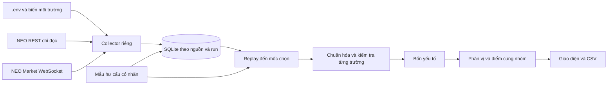

# Kiến trúc bản chuẩn bị trước khi có token

Collector là tiến trình riêng; Streamlit chỉ đọc kho, không giữ token hoặc tạo kết nối NEO.
`demo` dùng mẫu xác định; `live` dùng giờ hiện tại đọc run NEO mới nhất; `replay` dùng mốc trong dữ liệu đã lưu.
Nguồn synthetic và neo tách kho theo mặc định; engine từ chối trộn nguồn/run.

Nhật ký SQLite lưu payload thị trường nhận diện được, thời gian nhận có timezone, nguồn, run và channel.
Không lưu auth response; loại khóa nhạy cảm khỏi payload. Thông điệp lạ chỉ ghi trạng thái.
Khóa chống trùng gồm nguồn/run/thời gian/kênh/payload, không loại các snapshot giống nhau ở thời điểm nhận khác.
Danh sách VN30 lưu trong sự kiện universe mỗi lần bootstrap; reconnect lấy lại baseline.

Chuẩn hóa giữ số liệu vắng/null thành thiếu, ghi thời gian từng trường. Snapshot không tự forward-fill.
Patch là cấu hình cần kiểm chứng; trường vắng giữ cũ, null hủy giá trị, đồng hồ không làm mới theo hàng.
Dữ liệu khác ngày, cũ >60 giây, ngoài phiên LO hoặc số liệu cộng dồn giảm không được xếp hạng.
Replay xử lý theo thứ tự lưu, bỏ sự kiện sau mốc; timestamp nhận cũ không ghi đè bản mới.
Không có source timestamp đáng tin thì chưa giải quyết được độ trễ trước khi nhận tại máy.

Điểm thật có cổng `NEO_SEMANTICS_VERIFIED`; giả lập được phép tính để kiểm thử công thức.
Phương pháp `intraday-v1`, config_id, cohort_id, source/run và lý do loại đi cùng kết quả xuất CSV.
Chưa xây bảng normalized SQL riêng; hiện dựng chuẩn hóa từ journal và xuất CSV, ưu tiên tái tạo xác định.
Cần kiểm tra hiệu năng/độ phủ trên dữ liệu nhiều phiên trước khi tối ưu kho và cache.

Điểm tổng làm tròn 10 chữ số thập phân trước khi xếp hạng để tránh tách các điểm bằng nhau do sai số số thực. Giao diện hiển thị hai chữ số; dữ liệu xuất giữ độ chính xác tính toán.
